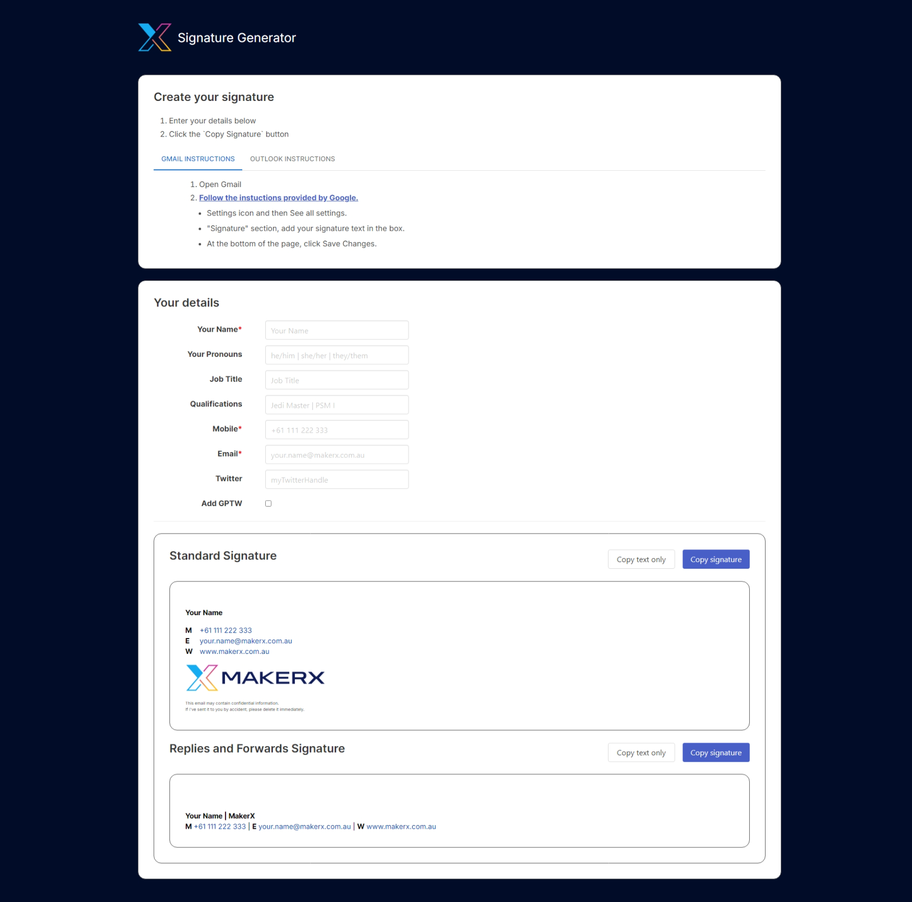

# MakerX Signature Generator

[](https://github.com/MakerXStudio/signature-generator/actions/workflows/ci.yml)
[](https://github.com/MakerXStudio/signature-generator/actions/workflows/cd.yml)

A small static React SPA used by staff to generate MakerX email signatures (both standard and replies-and-forwards variants, as HTML or plain text). Hosted via GitHub Pages at [https://signatures.makerx.tech](https://signatures.makerx.tech).

[](https://signatures.makerx.tech)

## Tech stack

- Vite 8 + React 19 + TypeScript
- MUI v9 (Emotion engine) for the application UI
- react-hook-form for form state
- libphonenumber-js for phone formatting
- Vitest + React Testing Library for tests
- ESLint 9 (flat config) + Prettier 3

The generated email signature itself stays as plain inline-styled HTML tables (no MUI, no CSS classes) so it pastes cleanly into Outlook, Gmail, and other email clients.

## Getting started

Requires **Node 22** (see `.nvmrc`).

```sh
nvm use            # picks up .nvmrc
npm install
npm run dev        # http://localhost:3000
```

### Scripts

| Script | What it does |
| --- | --- |
| `npm run dev` | Run the Vite dev server on port 3000 |
| `npm run build` | Typecheck and build a production bundle into `dist/` |
| `npm run preview` | Serve the built `dist/` for local smoke testing |
| `npm test` | Run Vitest (watch mode) |
| `npm test -- --run` | Run Vitest once |
| `npm run typecheck` | TypeScript `--noEmit` |
| `npm run lint` | ESLint over the repo |
| `npm run format` | Prettier write |

## Rebranding for another company

Brand-specific values live in `src/constants/index.ts`. Edit `brandInfo` (name, link, link colour, logo URLs) and `placeholders` (the greyed-out hints in the form), and the rest of the app follows.

## Embed mode

Visiting the app with `?embedded=1` (e.g. `https://signatures.makerx.tech/?embedded=1`) suppresses the top AppBar. Useful for iframing the generator into another page.

## Deploying

### First-time deploy setup

This repo deploys via GitHub's native Pages workflow (`actions/deploy-pages`), not the older `gh-pages` branch. **One manual step is required the first time:**

1. In the GitHub repo: **Settings → Pages**.
2. Under **Build and deployment → Source**, choose **GitHub Actions**.

Until that toggle is flipped, the `Build and Deploy` workflow will fail. The custom domain (`signatures.makerx.tech`) is preserved by `public/CNAME`, which is published in every build artifact.

### Subsequent deploys

Merging to `main` triggers the `Build and Deploy` workflow, which builds the site and deploys to the `github-pages` environment. No manual steps.

## CI / tooling notes

- Every GitHub Action is pinned to a full commit SHA with the version tag in a comment.
- Dependabot watches both `npm` and `github-actions` weekly; minor and patch updates are grouped.
- There is no Husky / pre-commit hook. CI runs `npm run lint`, `npm run typecheck`, `npm test`, `npm audit --audit-level=high --omit=dev`, and `npm run build` on every PR.
- **MUI majors are not handled by grouped Dependabot patches.** When MUI v10 lands, expect a deliberate upgrade PR (Stack API changed at v9, more may change at v10).

## Project history

Forked from Telstra Purple's signature generator. Modernised in May 2026 (CRA → Vite, JS → TS, Redux → react-hook-form, Bulma → MUI v9, gh-pages branch → native Pages deploy). MIT licensed; see [LICENSE](./LICENSE).
