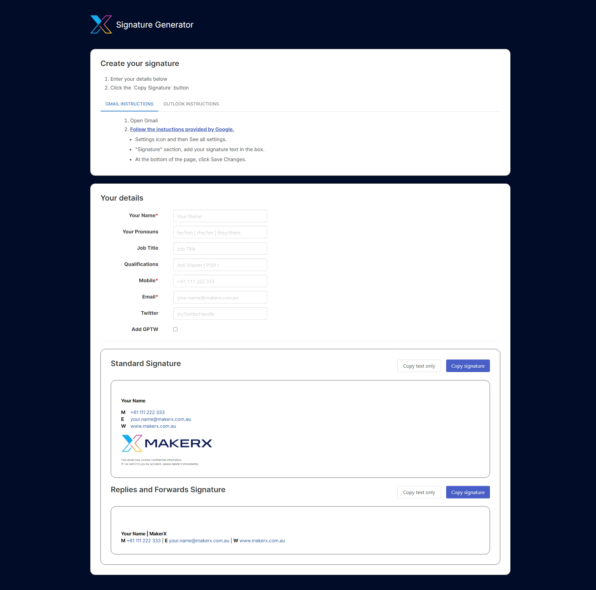

# MakerX Signature Generator

This app can be used to create a MakerX email signature.

### Looks great, how can I use it for my company?

`src/constants` Contains brand specific information. Edit fields in there to rebrand the website.

## Licence

Forked from Telstra Purple

MIT, See: [LICENSE](https://github.com/Readify/telstra-purple-signatures/blob/master/LICENSE)

## Getting Started

### Hosting

We host this webpage using [GitHub Pages](https://pages.github.com/) and a custom domain [https://signatures.makerx.tech](https://signatures.makerx.tech) with HTTPS enforced.

Check out the `ci.yml` and `cd.yml` files for how this is completed using GitHub Actions.

### Visual Studio Code

`launch.json` support is provided to launch this project by hitting F5.

### Development

Requires Node 24 (see `.nvmrc`). Install dependencies with `npm ci`, then:

- `npm start` (or `npm run dev`): runs the Vite dev server at [http://localhost:5173](http://localhost:5173) with hot reload.
- `npm test`: runs the Vitest tests in watch mode. `npm run test:ci` runs them once.
- `npm run lint`: runs ESLint. `npm run lint:fix` fixes what it can.
- `npm run format:check`: checks formatting with Prettier. `npm run format` rewrites files.
- `npm run check-types`: type checks with `tsc`.
- `npm run build`: type checks and builds the app for production into the `build` folder.
- `npm run preview`: serves the production build locally.

### Supported browsers for copying

Copying uses the async Clipboard API, so the page must be served over HTTPS or from localhost. The "Copy signature" buttons copy HTML with `ClipboardItem`, which requires Chrome, Edge, Safari 13.1 or later, or Firefox 127 or later. In other browsers those buttons show "Copy failed", and the "Copy text only" buttons still work.
